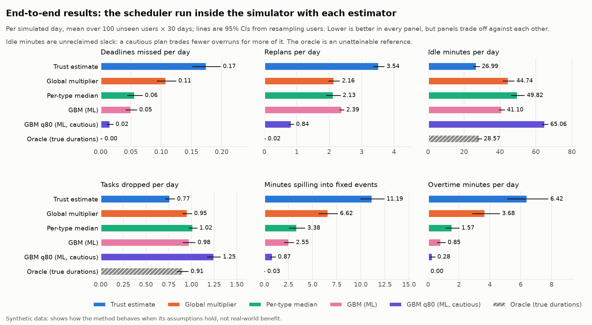
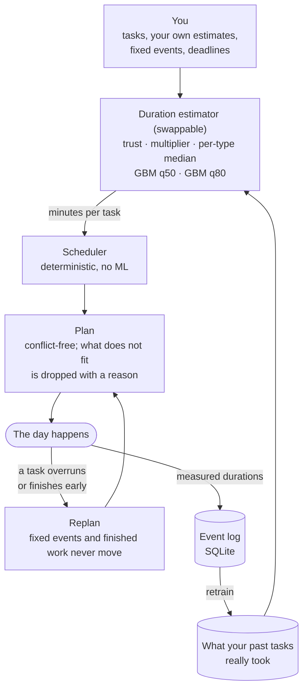
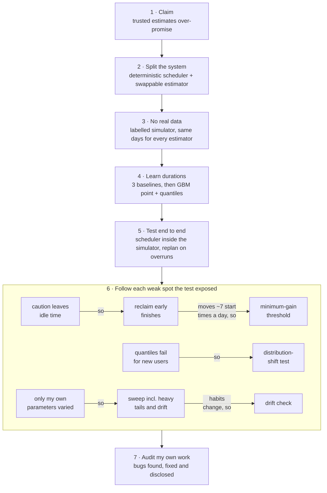
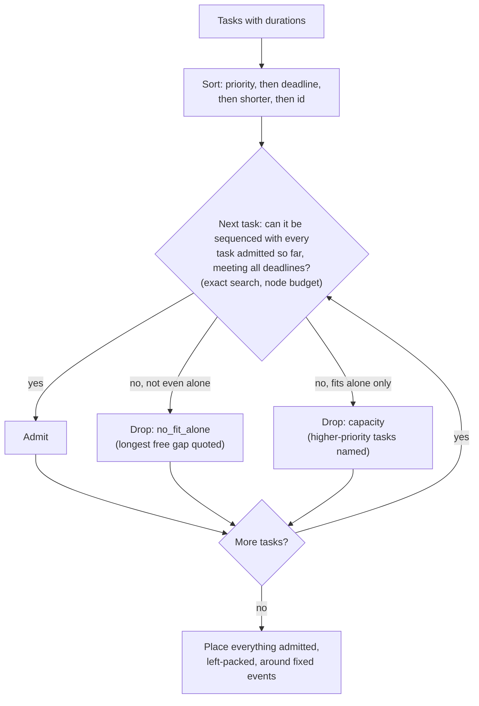
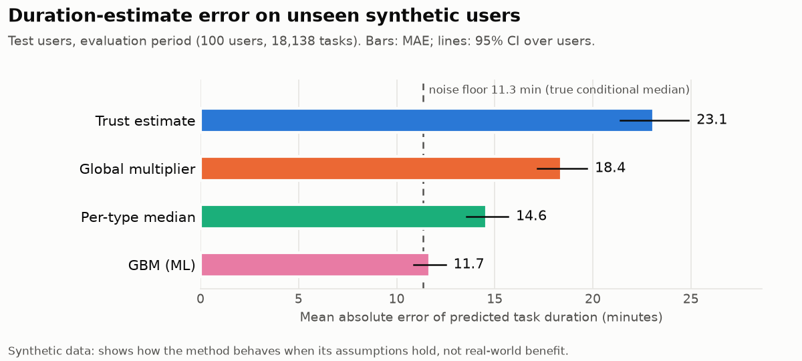
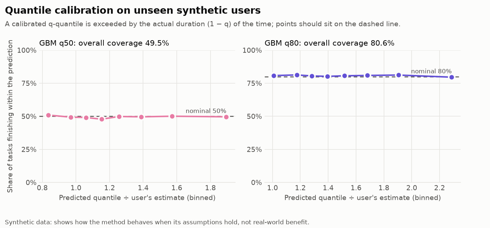
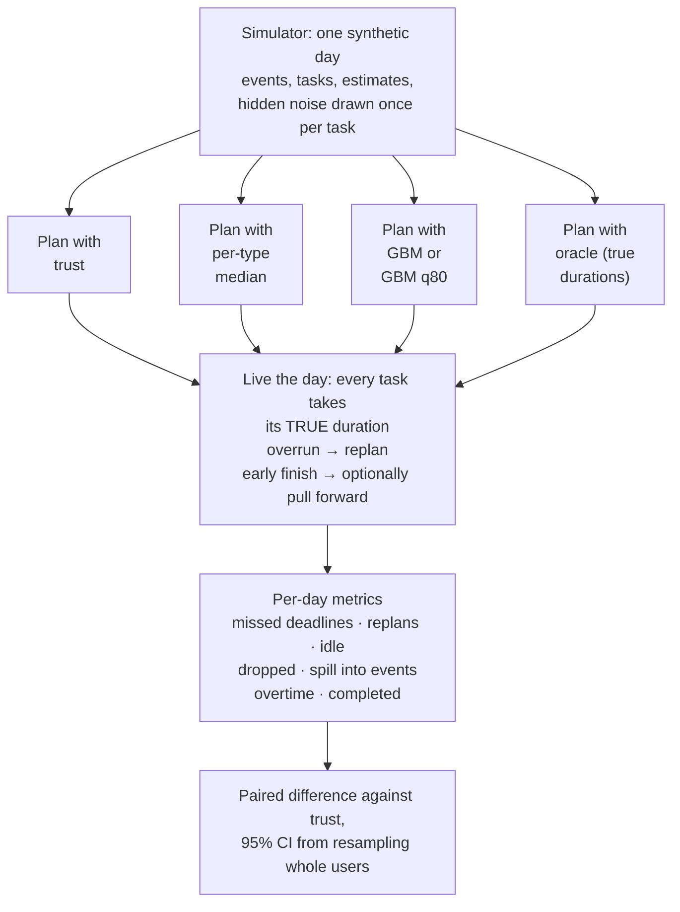
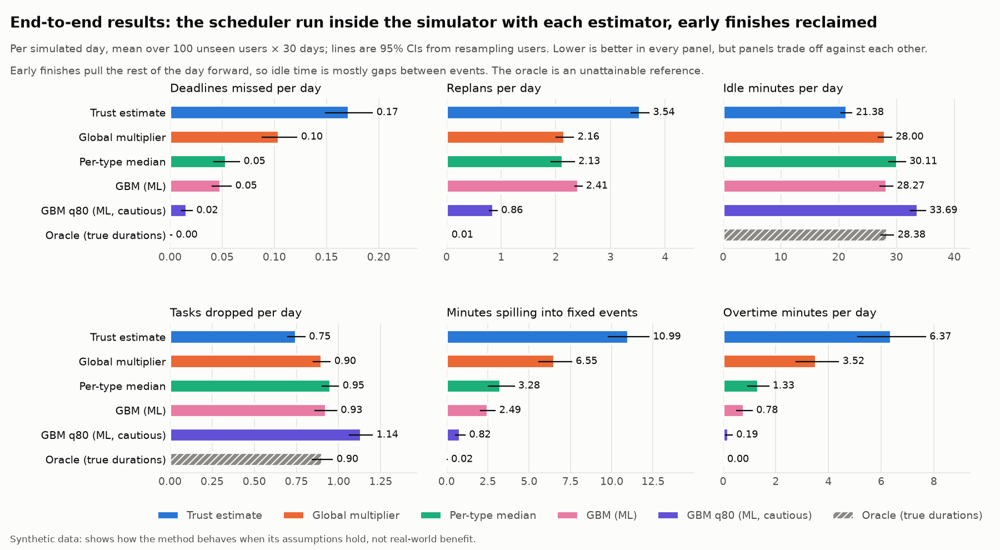
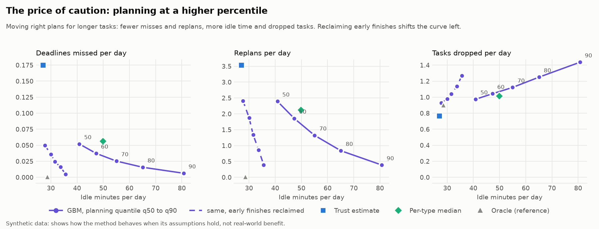

# FlowDay

An ML-informed daily scheduler. It plans a day around fixed events and flexible tasks, learns how long
tasks *actually* take compared with what the user estimated, and replans when a task overruns.

> **Everything in this repository that involves people is synthetic.** The users, task histories, biases
> and every number below come from a simulator written by the author. The results show how the method
> behaves *when its assumptions hold*. They are not evidence that it would help real people. See
> [Why these results do not prove real-world benefit](#why-these-results-do-not-prove-real-world-benefit).



## Contents

1. [The problem](#the-problem)
2. [The idea in seven steps](#the-idea-in-seven-steps) (start here if you want the whole argument in two minutes)
3. [Quick start](#quick-start)
4. [How it fits together](#how-it-fits-together)
5. [The scheduler: algorithm and tradeoffs](#the-scheduler-algorithm-and-tradeoffs)
6. [Synthetic data, and why results do not prove real-world benefit](#synthetic-data)
7. [Duration models](#duration-models)
8. [End-to-end evaluation](#end-to-end-evaluation)
9. [Event log](#event-log)
10. [The app](#the-app)
11. [Tests and quality](#tests-and-quality)
12. [Limitations and next steps](#limitations-and-next-steps)

## The problem

People plan their day from their own time estimates, and those estimates are biased: usually low, more so
for some kinds of work (writing and coding more than email), more for some people, and more at some times
of day. A planner that believes the estimates over-promises, so the day collapses into a chain of
overruns, missed deadlines and meetings that start while you are still working.

FlowDay separates two jobs:

1. **A deterministic scheduler** that, given durations, produces a conflict-free plan and an explanation
   for anything it could not fit. It contains no ML and can be reasoned about and tested exhaustively.
2. **A duration estimator** that turns "I think this takes 60 minutes" into a better number (a median, or a
   cautious 80th percentile), learned from what the user's past tasks really took.

The scheduler only ever sees a number of minutes per task, so estimators are swappable, which is what
makes the comparison in this README possible.



## The idea in seven steps

This is the argument of the whole project, with the path I took to it. Each step is a question; the next
step exists because the previous one answered it or exposed a weak spot.



1. **Is the claim even true?** People plan from their own estimates, and those are biased low. A planner that
   believes them should over-promise. Everything is measured against that baseline, "trust the user".
2. **How do I make the comparison fair?** I split the system in two: a deterministic scheduler with no ML
   (so it can be tested exhaustively) and a duration estimator that only hands it a number of minutes per
   task. Swapping the estimator is then the only thing that changes between plans. The scheduler is checked
   against a brute-force oracle and by injecting bugs to see that the tests notice.
3. **Where does data come from?** There is none that is real, so I wrote a documented bias model (task
   type, size, time of day, a personal offset, noise) and labelled everything `synthetic`. Every estimator
   sees the same days and the same hidden noise. The price: results show the method works *when its
   assumptions hold*, nothing more.
4. **How much of the bias can be learned?** Three baselines (trust, one global multiplier, a per-type
   median), then a gradient-boosted model with past-only history features, split by user. Against a noise
   floor of 11.3 minutes the GBM scores 11.7 and trust 23.1. The per-type median (14.6) is a strong
   baseline, and the quantile models are calibrated in-distribution.
5. **Does a better number make a better day?** Run the scheduler inside the simulator, let tasks take their
   true duration, replan on overruns. ML planning cuts missed deadlines from 0.17 to 0.05 a day and minutes
   spilling into meetings from 11.2 to 2.6, and it is paid for in throughput: trusting the user completes
   the most tasks (5.28 vs 5.07) by over-committing.
6. **What did that expose?** Each weak spot became the next piece of work: idle time from caution led to
   reclaiming early finishes; that reshuffled about seven start times a day, which led to a minimum-gain
   threshold; quantiles that fail for new users led to the distribution-shift test; "I only varied my own
   parameters" led to a sweep that includes heavy-tailed noise and drifting habits; changing habits led to a
   drift check.
7. **Can I trust my own work?** I audited it. The validator had silently lost four checks, and the baselines
   took a median on the wrong scale. Both are fixed and disclosed below instead of quietly corrected.

## Quick start

Requires [uv](https://docs.astral.sh/uv/) and Python 3.11+.

| Command | What it does | Time (laptop) |
|---|---|---|
| `make install` | create the virtualenv and install dependencies | |
| `make test` | the full pytest suite: unit, property-based, headless app, CLI and figure tests | ~1 min |
| `make check` | ruff + strict mypy on the package and the tests + the suite (what CI runs) | ~1.5 min |
| `make coverage` | the suite with line coverage | ~1.5 min |
| `make mutation` | inject known bugs into the scheduler; every non-equivalent one must be caught | ~1 min |
| `make train` | generate synthetic data, tune and train models, write `artifacts/` and `reports/model_metrics.json` | 1 to 3 min |
| `make evaluate` | run the scheduler end to end with every estimator, early finishes not reclaimed and reclaimed; write `reports/` and figures | 2 to 4 min |
| `make sensitivity` | feature ablation, generator sweep (seeds, noise, bias, heavy tails, drifting habits), the caution frontier, the reclaim threshold and the drift check | ~20 to 25 min |
| `make figures` | regenerate the figures from the JSON reports | seconds |
| `make app` | launch the Streamlit app (run `make train` first for the ML estimators) | |
| `make synth-log`, `make retrain-from-log` | write a synthetic event log, then retrain the models from a log | seconds |

Timings are on a laptop that was also busy with other work; they vary a lot with load.

Everything is seeded. Re-training and re-running the evaluation reproduced the committed `reports/` byte for
byte (checked with `git diff`, in a fresh clone for the first version and again in the working tree after the
latest changes, which left every earlier number untouched). One exception, disclosed: in my first run of
`make sensitivity`, one of its simulated worlds (base, seed 2) differed slightly from a clean rerun,
probably because it ran while I was editing scheduler files. The committed file is the clean output, an
independent recompute of that world matched it exactly, and a full rerun after the latest changes
reproduced it again. Generated data (`data/`) and trained models (`artifacts/`) are git-ignored. CI (`.github/workflows/ci.yml`) runs `make check` on Python 3.11, 3.12 and
3.13; I ran the same locally on all three for an earlier commit, and the workflow has passed on GitHub (Linux)
for the commits up to the README rewrite.

### Putting it online (free)

Two separate things, both optional:

- **A project page on github.io.** `docs/index.html` is a static page (the argument, the diagrams, the results, the
  limits). In the repository settings choose *Pages, deploy from a branch*, branch `main`, folder `/docs`. `make site`
  refreshes its figure and the three real plans it draws (`docs/day.json`); the other numbers in it are copied by
  hand from this README, so change them together.
- **A live app on Streamlit Community Cloud.** GitHub Pages cannot run a Python server, so the app needs its own host.
  At <https://share.streamlit.io> create an app from this repository with main file `flowday/app/main.py`, pick
  Python 3.12 under *Advanced settings*, and add the secret `FLOWDAY_HOSTED = "1"` (Streamlit exposes root-level
  secrets as environment variables). Hosted mode trains its small demo model itself on first load (about 13 s on a
  laptop; slower on a shared host), keeps **no event log** (the log is one file that every visitor would otherwise
  share), and hides the "learn from my own log" controls. `requirements.txt` is pinned from `uv.lock`
  (`uv export --no-dev --no-hashes --no-emit-project`, plus a line that installs the package itself); regenerate it
  when the dependencies change. I tested the app from that file in a clean Python 3.12 environment, not on
  Streamlit Cloud itself.

## How it fits together

```
flowday/
  scheduler/    deterministic core: Event, Task, Schedule, build_schedule, replan, complete,
                expand_routines, validate_schedule. Standard library only.
  simulator/    synthetic users, days and histories; simulate_day executes a plan with true durations
                (optionally reclaiming early finishes) and measures how much each replan disturbs the day
  models/       features, 3 baselines, GBM point + quantile models, metrics, train CLI,
                retrain.py (fit the models from an event log)
  planning.py   glue: sizes tasks with an estimator, then schedules / replans
  dataset.py    builds the synthetic dataset (and applies the generator knobs)
  evaluation/   end-to-end runner (parallel, paired, cluster-bootstrap CIs), sensitivity analyses, figures
  eventlog/     SQLite schema (v2, with migration), observer that logs plans, completions and durations,
                and simulate.py to write synthetic days into a log
  app/          Streamlit app; pure logic lives in session.py / inputs.py so it is unit-tested
scripts/        mutation_check.py: inject known bugs into the scheduler and check the tests notice;
                anchor_experiment.py: an experiment that was tried and not adopted (see "Synthetic data");
                make_site_data.py: exports the three real plans the project page draws
docs/           the static github.io project page (index.html, day.json, one figure)
tests/          pytest + hypothesis
reports/        committed results: JSON, markdown tables and figures
```

The dependency direction is `scheduler` ← `simulator` ← `models` ← `planning` ← `evaluation` / `app`.
`scheduler` never imports anything else in the project.

## The scheduler: algorithm and tradeoffs

**Model.** Times are integer minutes from an arbitrary origin. Work happens inside *windows* (one per
day, so multi-day horizons work). *Fixed events* block time. *Tasks* have a type, a duration, an optional
hard deadline, an optional release time (earliest start) and a priority (1 to 5, 5 most important). Tasks
are non-preemptible: each gets one contiguous slot inside a single free gap.

**Algorithm.**

1. Compute free time: windows minus fixed events minus already-completed work, clipped to `now`.
2. Walk the tasks from highest priority down (ties: earlier deadline, then shorter, then id).
3. *Admit* a task only if the already-admitted tasks plus this one can still all be sequenced with every
   deadline met. That feasibility check is an exhaustive depth-first search over task orders, with
   earliest-deadline-first as the first thing it tries, memoisation on (set placed, time), a cheap
   per-deadline capacity bound, and a node budget (20,000).
4. Otherwise *drop* the task and say why: `no_fit_alone` (not even placeable on an otherwise empty
   calendar, with the longest free gap quoted) or `capacity` (fits alone, but not beside the
   higher-priority tasks, which are named).



The search is complete: if any sequencing meets every deadline, some earliest-fit-after-the-previous-task
sequencing does (shifting any task left to its earliest fit cannot hurt a deadline), so with the budget
not hit, **nothing is dropped whenever everything fits.**

**`replan(schedule, now, overrun)`** records the overrunning task as completed over its *actual* interval
(planned start to planned end plus the overrun), then re-runs the algorithm on everything not completed,
from `max(now, that end)`. It never changes fixed events or completed work. Tasks that were planned before
`now` but never completed are treated as not done, and previously dropped tasks get another chance.
Fixed events are never moved even if the overrunning task ran into one: that collision is reported
(`collisions()`), not hidden.

```mermaid
gantt
    title One overrun, replanned (illustrative: fixed events stay put, finished work is frozen)
    dateFormat HH:mm
    axisFormat %H:%M
    section Plan at 09:00
    Standup (fixed)                  :crit, e1, 09:00, 30m
    Write report                     :a1, 09:30, 60m
    Email                            :a2, 10:30, 30m
    Review PR                        :a3, 11:00, 60m
    Lunch (fixed)                    :crit, e2, 12:00, 60m
    section Report ran 30 min over, replanned at 11:00
    Standup (fixed)                  :crit, f1, 09:00, 30m
    Write report (actual)            :done, b1, 09:30, 90m
    Email                            :b2, 11:00, 30m
    Lunch (fixed)                    :crit, f2, 12:00, 60m
    Review PR (no longer fits before lunch) :b3, 13:00, 60m
```



**Recurring routines** (`Routine`, `expand_routines`) expand a daily or per-weekday pattern into fixed
events (a study block at 19:00) or flexible tasks (study for 60 minutes before 21:00). A flexible instance
is released at the start of its own day, so tomorrow's study block is never planned today. (An earlier
version had no release times and did plan it today; a multi-day test through the estimator planner caught
it. Within the search, tasks that can start now are tried before tasks that must wait for their release,
so a late release does not leave a morning empty; tasks without a release keep their exact earlier order.)

**Tradeoffs, stated honestly.**

- *Not globally optimal.* Priority-ordered admission is a greedy rule on top of an exact feasibility
  check. It guarantees a task is never dropped to make room for something that ranks lower (a property
  test checks this against a brute-force oracle), but it can drop more total value than the best possible
  selection. It is also not monotone: removing one task can admit a larger one that then crowds out a
  third. A property-based test found exactly this while I was writing the suite; it is a consequence of
  the rule, not a bug.
- *Exponential worst case.* The problem is NP-hard even with gaps. In practice the first branch (EDF) or
  the capacity bound settles typical days in a handful of nodes. If the budget is exhausted the result is
  still valid (no deadline is ever missed) but may drop more than necessary, and
  `Schedule.search_truncated` says so. In an instrumented run of 4,500 simulated days (73,497 feasibility
  searches) the budget was never reached.
- *No splitting, no dependencies, no travel time or buffers.* Each is a reasonable extension; none is
  modelled. (Release times exist, but only routines use them.)
- *Placement is earliest-fit, left-packed.* Good for deadlines, indifferent to what a person would rather
  do at which hour.
- *Deadlines are hard.* There is no "late but still worth doing" option.

**Evidence it is correct** (all in `tests/`, run by `make test`):

| Property | How it is checked |
|---|---|
| No two scheduled items overlap; nothing outside work hours; every placed task ends by its deadline and has its full length; nothing starts before `now`; every task is exactly one of placed / completed / dropped | hypothesis, 200 random scenarios, `validate_schedule` |
| Fixed events never move | hypothesis, events compared before and after, including through whole days of replans |
| Nothing is dropped when a feasible schedule exists, and vice versa | hypothesis against an independent brute-force oracle (every permutation, minute-grid representation) |
| A planted exact packing (tasks that tile the free time exactly, so demand equals capacity) is always found | hypothesis, `planted_scenarios` |
| A task is dropped only if it cannot fit beside the tasks that outrank it | same oracle |
| Drop reasons are truthful | each `no_fit_alone` / `capacity` claim is re-checked by scheduling the task alone |
| Replanning never touches completed work, places nothing before `now` or before the overrun ends | hypothesis over random completion prefixes, overruns and clock values, including a clock *inside* completed work |
| An exhausted search budget gives a worse packing, never an invalid one, and says so | node budgets of 1, 3 and 10 against the same scenarios; untruncated results equal the exact ones |
| The validator itself detects each kind of violation | `tests/test_validate_and_budget.py` corrupts a valid schedule nine ways |
| Deterministic | same input, equal output |

**A correction.** An earlier version of this README said `validate_schedule` checked deadlines, work-hour
containment, task length and "nothing before now". It did not: a refactor of the validator had silently
deleted those four checks, so the property tests were not verifying them (the scheduler itself passed all of
them once the validator was fixed). I found this only when I wrote tests for the validator itself, which I
should have written first. The checks are restored, each has a test, and the mutation check below now
catches bugs through the validator.

**Do the tests fail when the code is wrong?** `make mutation` (`scripts/mutation_check.py`) injects nine
known bugs into the scheduler (ignore deadlines, ignore fixed events, ignore work windows, forget completed
work when replanning, record the wrong overrun end, an off-by-one in the pruning rule, admit low priority
first, ignore release times, stop clipping free time at `now`), runs only the property tests meant to catch
each, and restores the file. Eight are caught. The ninth is an *equivalent mutant*: the search already starts at `now`, so
clipping free time there changes no behaviour and no test can or should catch it. The off-by-one pruning
mutant initially survived random testing, because random scenarios almost never make demand exactly equal
capacity; that is why the planted exact-packing property exists.

## Synthetic data

There is no real data in this project. `flowday/simulator/profiles.py` defines the generative model, and
every row carries `source = "synthetic"`.

```
log(actual / estimate) = log(type_factor[type])                      systematic bias by task type
                       + user.offset                                 per-user bias, ~ N(0, 0.15)
                       + user.size_slope * log(estimate / 30)        bigger tasks are underestimated more
                       + user.tod_scale * type_tod[type] * tod(hour) slower away from the user's peak hour
                       + user.noise_sigma * z,  z ~ N(0, 1)          noise (sigma ~ 0.22, varies by user)
```

`tod(hour)` is zero at the user's chronotype peak (drawn around 11:00), rises to one twelve hours away,
plus a post-lunch dip around 14:00.

| Task type | email | admin | errands | meeting prep | exercise | study | writing | coding |
|---|---|---|---|---|---|---|---|---|
| base actual/estimate | 1.00 | 1.10 | 1.10 | 1.15 | 0.95 | 1.20 | 1.35 | 1.40 |
| time-of-day sensitivity | 0.10 | 0.10 | 0.05 | 0.20 | 0.05 | 0.30 | 0.35 | 0.30 |

Two optional departures from this form exist, off by default and used only by the sensitivity sweep:
`tail_df` draws `z` from a Student-t (scaled to unit variance) so a few tasks blow up, and `drift_sd` gives
each user a habit whose bias drifts linearly with the day at a personal rate.

After all effects, the median actual/estimate in the generated data is 1.23 overall (mean 1.32): coding
1.66, writing 1.60, study 1.40, meeting prep 1.23, admin 1.12, errands 1.11, email 1.00, exercise 1.00. Each synthetic day has 1 to 3
meetings and 4 to 8 tasks; about 55% of tasks have a same-day deadline. Hidden noise is drawn once per
task, so every estimator is evaluated on exactly the same days and the same "true" durations (common
random numbers).

### Why these results do not prove real-world benefit

- **The model was told the answer's shape.** The generator is log-linear in a handful of features the
  estimator is given. A gradient-boosted model recovering it to within a few minutes of the theoretical
  noise floor (below) says the pipeline works, not that human durations are this learnable.
- **The biases are my assumptions**, loosely inspired by the planning-fallacy literature, not measured.
  Magnitudes, the type ranking and the time-of-day curve could all be wrong in reality.
- **Almost nothing is non-stationary.** Real people change habits, have good and bad weeks, get interrupted,
  and change their estimates *because* a planner exists. Here each user's parameters are frozen, except in one
  sweep world where every user's bias drifts steadily (below).
- **Plans are followed perfectly.** No one skips a task, reorders, takes a call, or ignores the app.
- **Tasks are independent and clean.** Real task types are messy free text, not eight clean labels.
- **A narrow set of design choices.** The headline numbers come from one seed. The sensitivity runs below
  vary the seed, the noise and the bias strength, and add two departures from the generator's form (heavy
  tails, drifting habits). The direction of the results holds, but the model family and the estimator set
  were not varied, and both departures are still mild. Intervals reflect sampling noise over simulated users, not
  uncertainty about the simulator itself.
- **Calibration is in-distribution.** The stress test below shows how quickly that breaks.

The first line of defence is the oracle and the noise floor, which stop me from reading too much into
small gaps. The second is a **distribution-shift test** (the third, a sweep over the simulator's own
parameters, follows it): score the already-trained models on a population
in which every user underestimates 0.30 more (on the log scale) than anyone in training, with no
retraining.

| Shifted population | MAE trust | MAE per-type median | MAE GBM | q50 coverage (nominal 0.50) | q80 coverage (nominal 0.80) |
|---|---|---|---|---|---|
| first 7 days of a user's history | 44.5 | 29.0 | 19.5 | **0.35** | **0.68** |
| days 60 to 89 | 43.6 | 28.2 | 16.1 | 0.48 | 0.80 |

The point predictions stay best, but the quantiles are badly miscalibrated for new users and only recover
once the model has personal history to correct for (it sees each user's past actual/estimate ratios).
That is a feature of how this particular model uses history, and it is the kind of failure to expect from
real data too.

I tried the obvious repair, `scripts/anchor_experiment.py`: train on the log-ratio minus the user's shrunk
history mean and add it back, so the part that has to extrapolate is linear (trees cannot extrapolate, and
shifted users sit well outside the training range). In-distribution nothing changes, but in the first shifted
week q80 coverage only moves from 0.68 to 0.72 (target 0.80). Most of the gap is tasks with no history at all
(14% of first-week tasks, which the trained q80 covers 41% of), and nothing built from history can fix
those. So it was **not adopted**, and no headline number depends on it. What would help is faster feedback
from the first few completions or a population prior that adapts, neither of which exists here.

**Sensitivity to the simulator's own parameters.** `make sensitivity` regenerates the world with different
random seeds, with the noise doubled or halved, with the systematic biases scaled by 0.5 or 1.5, and in two
worlds that change the *form* of the generator (heavy-tailed noise: Student-t with 4 degrees of freedom at the
same variance; drifting habits: each user's bias changes linearly at a personal rate, sd 0.003 log-units a
day, about 0.27 by day 90). It retrains and re-runs the end-to-end evaluation each time (250 users per world,
so the base row differs slightly from the headline run):

| World | median actual/estimate | MAE trust / per-type / GBM | Deadlines missed: trust → GBM → q80 | Min spilling into events: trust → GBM |
|---|---|---|---|---|
| base, seed 0 | 1.24 | 23.3 / 15.1 / 11.3 | 0.19 → 0.05 → 0.02 | 11.8 → 2.5 |
| base, seed 1 | 1.21 | 24.7 / 15.9 / 12.5 | 0.17 → 0.04 → 0.01 | 12.6 → 2.7 |
| base, seed 2 | 1.24 | 24.1 / 15.2 / 12.4 | 0.18 → 0.04 → 0.01 | 12.2 → 2.3 |
| noise x0.5 | 1.23 | 21.0 / 11.5 / 5.9 | 0.17 → 0.02 → 0.01 | 10.4 → 0.6 |
| noise x2 | 1.25 | 31.6 / 25.7 / 23.6 | 0.23 → 0.10 → 0.03 | 16.4 → 6.6 |
| bias x0.5 | 1.12 | 14.0 / 11.8 / 9.2 | 0.12 → 0.05 → 0.02 | 5.5 → 1.8 |
| bias x1.5 | 1.36 | 36.6 / 19.8 / 14.1 | 0.29 → 0.06 → 0.02 | 18.2 → 2.4 |
| heavy-tailed noise | 1.23 | 23.7 / 14.9 / 10.8 | 0.18 → 0.04 → 0.01 | 11.0 → 2.2 |
| drifting habits | 1.25 | 24.8 / 17.8 / 11.9 | 0.20 → 0.05 → 0.02 | 11.8 → 2.0 |

The direction of every result is the same in all nine worlds: the ML plan misses fewer deadlines and spills
into fewer events than trusting the user, and the cautious plan misses fewer still. What moves is the size of
the gain. Across three seeds the GBM's error varies by about a minute (11.3 to 12.5). The GBM's edge over the
per-type median is largest when noise is low (5.9 vs 11.5) and shrinks to about two minutes when noise is
doubled (23.6 vs 25.7), as expected when most of the variation is irreducible. Weaker biases (x0.5) make
trusting the user less bad (0.12 missed deadlines a day vs 0.29 at x1.5) and leave less for the model to
fix.

The last two rows are the ones that change the generator's form, and neither breaks anything. **Heavy tails**
barely move the error (GBM 10.8 minutes) and leave the quantiles calibrated (q50 / q80 coverage 0.50 / 0.81):
the pinball loss does not care about a few extreme tasks, and at equal variance heavy tails put *more* mass
near the median, so absolute error is not a harder test here. **Drifting habits** hurt the per-type median
most (15.1 to 17.8 minutes) and the GBM least (11.3 to 11.9), so the GBM's edge over the median grows (-6.0
minutes against -3.8), because its history features follow a user's recent ratios, if with a lag. These are
two mild departures that are still log-linear plus noise; a step change in habits, tasks that depend on each
other, or a user who changes their estimates in response to the planner were not tried. I would not read
"robust" into this beyond what the rows show.

The **drift check** (below, under the event log) fires on 28 of 100 users in the drifting world and 2 of
100 in a stable one (14-day window, |z| > 3). Detection follows how fast a user drifts: it flagged 2 of the
50 slowest-drifting users (a typical shift of under 0.1 on the log scale between the window and what came
before, which is inside the noise) and 16 of the 25 fastest. Two percent false alarms is more than the 0.3%
a normal approximation would promise; I did not investigate why (non-independent residuals within a user are
the likely cause), so treat |z| > 3 as a rough setting, not a calibrated one.

## Duration models

All models predict *actual minutes* from `(task type, user's estimate, start hour, user history)`.

| Model | What it is |
|---|---|
| `trust` | (a) believe the user's estimate |
| `global_multiplier` | (b) estimate x the median actual/estimate over all training tasks |
| `type_median` | (c) estimate x the median actual/estimate for that task type |
| `gbm` | gradient boosting (scikit-learn `HistGradientBoostingRegressor`) on `log(actual / estimate)`; point estimate |
| `gbm_q50`, `gbm_q80` | the same model with pinball loss for the 50th and 80th percentile. Quantiles are unchanged by the log transform, so `exp(prediction)` is a quantile of actual duration |

I used scikit-learn rather than LightGBM to avoid a native OpenMP dependency on macOS.

**Features.** log estimate, task type, start hour, and four *past-only* history features per user: the mean
log(actual/estimate) over all their earlier tasks and over earlier tasks of the same type, with counts.
"Past-only" means strictly earlier days, because outcomes of the same day are unknown when it is planned.
Leakage is the easy way to fool yourself here, so it is tested directly: changing the outcome of any row
must not change the features of any row on the same or an earlier day (a hypothesis test), and the
estimators are shown a spy-checked frame that contains no outcome column. Missing history (a brand-new
user) is handled natively, so cold-start users still get a prediction.

**Split.** 500 synthetic users, 90 days each (about 270,000 tasks), split **by user**: 300 train, 100
validation, 100 test. No user appears in two sets (asserted in code and in a test). Hyper-parameters are
chosen on validation users (a four-point grid); every number below is from test users. Days 60 to 89 of
each timeline are the evaluation period used in the end-to-end run, and days 0 to 6 are the cold-start
slice.

**Accuracy** (mean absolute error in minutes on the 100 test users; 95% CI from resampling whole users,
since one user's tasks are correlated):

| Estimator | All test days (54,044 tasks) | First 7 days | Evaluation period |
|---|---|---|---|
| trust | 23.2 [21.6, 24.9] | 22.9 [21.0, 24.7] | 23.1 [21.4, 24.9] |
| global_multiplier | 18.5 [17.3, 19.8] | 18.1 [16.8, 19.6] | 18.4 [17.2, 19.7] |
| type_median | 14.6 [13.6, 15.6] | 14.4 [13.3, 15.6] | 14.6 [13.6, 15.7] |
| **gbm** | **11.8 [11.1, 12.6]** | **12.6 [11.6, 13.6]** | **11.7 [10.9, 12.5]** |
| gbm_q50 | 11.9 [11.1, 12.6] | 12.7 [11.8, 13.7] | 11.7 [10.9, 12.5] |
| *noise floor: true conditional median* | *11.4 [10.6, 12.1]* | *11.4 [10.6, 12.3]* | *11.3 [10.5, 12.1]* |

The GBM beats the per-type median by 2.7 minutes overall (paired 95% CI 2.1 to 3.4), which is the
increment attributable to time of day and per-user history beyond task type. Trusting the user
under-predicts by 20.5 minutes per task on average (bias), the per-type median by 3.1, the GBM by 2.1. The
noise floor is the MAE of an estimator that knows each synthetic user's true parameters, so the GBM being
close to it is a statement about the simulator's simplicity as much as about the model.



**Quantile calibration** (test users): the 50th-percentile model was exceeded by 49.5% of actual
durations (CI 48.9% to 50.1%) and the 80th by 80.6% (CI 79.5% to 81.8%), across task types within 0.49 to
0.51 and 0.80 to 0.83 and across times of day within 0.01. Reading the baselines as if they were
medians: trusting the user covers only 30% of outcomes.



The other planning percentiles used later are equally calibrated (share of test durations at or below the
prediction: q50: 0.495 | q60: 0.600 | q70: 0.703 | q80: 0.806 | q90: 0.906).

**Which features earn their keep?** Retraining the GBM with one feature group replaced by a constant
(`make sensitivity`; same tuned settings, test users, paired CIs):

| GBM variant | MAE, all test days | MAE, first 7 days | Change vs full model (all days, paired 95% CI) |
|---|---|---|---|
| full model | 11.8 [11.1, 12.6] | 12.6 [11.6, 13.6] |  |
| no history features | 14.1 [13.2, 15.2] | 14.1 [13.1, 15.3] | +2.31 [+1.72, +2.97] |
| no per-user history | 12.0 [11.2, 12.7] | 13.2 [12.3, 14.2] | +0.14 [+0.10, +0.17] |
| no per-user-and-type history | 11.9 [11.1, 12.7] | 12.6 [11.7, 13.5] | +0.07 [+0.02, +0.12] |
| no start hour | 12.2 [11.5, 13.1] | 13.0 [12.0, 13.9] | +0.41 [+0.29, +0.53] |
| no task type | 12.0 [11.2, 12.8] | 13.5 [12.6, 14.4] | +0.15 [+0.12, +0.17] |
| estimate only | 15.7 [14.8, 16.7] | 15.7 [14.6, 16.9] | +3.87 [+3.31, +4.49] |

The two history groups substitute for each other (removing either alone barely matters; removing both costs
2.3 minutes, 1.5 of them in a user's first week), so the history features are collectively the largest
contributor, followed by the start hour. Task type matters little once history is available, because
per-type history already encodes it. Using only the user's estimate (including its size effect) is worse
than the per-type median baseline, so the gain is not coming from the estimate alone.

## End-to-end evaluation

For each of the 100 test users and each of their 30 evaluation days (3,000 days), the scheduler plans the
day with an estimator and the simulator lives it: tasks start at their planned time and take their *true*
duration (which depends on the hour they start). **Whenever a task finishes later than planned, the day is
replanned from that moment.** A task that finishes early is not rewarded: the next one waits for its
planned start, so unused slack shows up as idle time (the headline setting; reclaiming it is evaluated
further down). Six estimators are compared; "oracle" knows the true
durations and is an unattainable reference. Because durations depend on start time and start time depends
on durations, hour-dependent estimators size tasks, schedule, re-size each task for the slot it landed in,
and schedule again (two passes).



Per simulated day, mean with 95% CI (resampling users):

| Estimator | Deadlines missed | Replans | Idle min | Tasks dropped | Min spilling into fixed events | Overtime min | Tasks completed |
|---|---|---|---|---|---|---|---|
| Trust estimate | 0.17 [0.15, 0.20] | 3.54 [3.37, 3.70] | 27.0 [25.4, 28.6] | 0.77 [0.72, 0.81] | 11.2 [10.0, 12.4] | 6.4 [5.1, 7.8] | 5.28 [5.22, 5.34] |
| Global multiplier | 0.11 [0.09, 0.12] | 2.16 [2.00, 2.32] | 44.7 [41.8, 47.8] | 0.95 [0.91, 1.00] | 6.6 [5.7, 7.6] | 3.7 [2.9, 4.6] | 5.09 [5.04, 5.14] |
| Per-type median | 0.06 [0.04, 0.07] | 2.13 [1.92, 2.34] | 49.8 [46.3, 53.6] | 1.02 [0.97, 1.06] | 3.4 [2.6, 4.2] | 1.6 [1.2, 2.0] | 5.03 [4.98, 5.08] |
| GBM (ML) | 0.05 [0.04, 0.06] | 2.39 [2.33, 2.45] | 41.1 [39.7, 42.6] | 0.98 [0.91, 1.04] | 2.6 [2.1, 3.0] | 0.9 [0.6, 1.1] | 5.07 [5.00, 5.14] |
| GBM q80 (ML, cautious) | 0.02 [0.01, 0.02] | 0.84 [0.77, 0.90] | 65.1 [63.5, 66.7] | 1.25 [1.18, 1.32] | 0.9 [0.6, 1.2] | 0.3 [0.2, 0.5] | 4.80 [4.72, 4.87] |
| Oracle (true durations) | 0.00 [0.00, 0.00] | 0.02 [0.02, 0.03] | 28.6 [27.5, 29.7] | 0.91 [0.85, 0.97] | 0.0 [0.0, 0.1] | 0.0 [0.0, 0.0] | 5.14 [5.08, 5.21] |

(Full numbers and paired differences against "trust" are in `reports/schedule_results.json`; a day has
about six tasks.)

What this shows, and does not:

- **Better durations make days more reliable.** Against trusting the user, the ML median plan cuts missed
  deadlines from 0.17 to 0.05 per day (paired difference -0.12, CI -0.14 to -0.11), minutes spilling into
  fixed events from 11.2 to 2.6, and overtime from 6.4 to 0.9.
- **There is no free lunch; the gain is paid for in throughput and idle time.** Trusting the user
  *completes the most tasks* (5.28 per day, more than the oracle's 5.14) because it over-commits and then
  gets them done by spilling into meetings, working overtime and missing deadlines. ML planning drops about
  0.2 more tasks per day, up front and with a reason, instead of failing them later. Whether that is the
  right trade depends on what an overrun costs a person, which this study cannot measure.
- **Planning at the median still overruns about half the time.** Replans fall only from 3.5 to 2.4 per day
  for the median GBM, because roughly half of tasks exceed their median by construction. The cautious
  80th-percentile plan is what cuts replans (0.84 per day) and misses (0.02), at the cost of 24 more idle
  minutes per day than the median GBM plan (65 vs 41; 38 more than trusting the user, CI +36 to +40) and
  0.27 more dropped tasks per day (1.25 vs 0.98). In this headline setting that idle time is mostly an
  artifact of not reclaiming early finishes; the next section removes it and measures what is left.
- **The per-type median is a strong baseline.** It is within noise of the GBM on missed deadlines
  (0.06 vs 0.05), has slightly fewer replans (2.1 vs 2.4), and is far better than the global multiplier.
  The GBM's clearest edge is overtime (1.6 to 0.9, non-overlapping CIs); its edge on minutes spilling into
  fixed events (3.4 to 2.6) is within noise. With no real data to validate on, the per-type ratio is the
  lowest-risk piece to ship: it is simple and captures most of the benefit.
- **The oracle is not perfectly zero** (0.001 missed deadlines and 0.02 replans per day): sizing tasks for
  the slot they land in is a fixed-point iteration that very rarely fails to converge in four passes.
  This is an approximation in the reference, not in the scheduler.


### Reclaiming early finishes

The headline setting above never reclaims time: a task that finishes early leaves a gap until the next one is
due. With `reclaim_early` (always on in the app) an early finish also triggers a replan from that moment,
pulling the rest of the day forward. Same days, same estimators, same hidden noise:

| Estimator | Deadlines missed | Replans | Idle min | Tasks dropped | Min spilling into events | Tasks completed |
|---|---|---|---|---|---|---|
| Trust estimate | 0.17 [0.15, 0.19] | 3.54 [3.37, 3.70] | 21.4 [20.4, 22.3] | 0.75 [0.70, 0.80] | 11.0 [9.8, 12.3] | 5.30 [5.24, 5.36] |
| Global multiplier | 0.10 [0.09, 0.12] | 2.16 [2.00, 2.32] | 28.0 [26.9, 29.2] | 0.90 [0.85, 0.95] | 6.5 [5.6, 7.6] | 5.15 [5.09, 5.20] |
| Per-type median | 0.05 [0.04, 0.07] | 2.13 [1.91, 2.34] | 30.1 [28.7, 31.5] | 0.95 [0.90, 1.00] | 3.3 [2.5, 4.1] | 5.09 [5.04, 5.15] |
| GBM (ML) | 0.05 [0.04, 0.06] | 2.41 [2.35, 2.48] | 28.3 [27.2, 29.4] | 0.93 [0.86, 0.99] | 2.5 [2.1, 2.9] | 5.12 [5.05, 5.19] |
| GBM q80 (ML, cautious) | 0.02 [0.01, 0.02] | 0.86 [0.79, 0.93] | 33.7 [32.4, 35.0] | 1.14 [1.07, 1.20] | 0.8 [0.5, 1.1] | 4.91 [4.84, 4.99] |
| Oracle (true durations) | 0.00 [0.00, 0.00] | 0.01 [0.01, 0.02] | 28.4 [27.3, 29.5] | 0.90 [0.84, 0.96] | 0.0 [0.0, 0.0] | 5.14 [5.08, 5.21] |



Reclaiming removes most of the idle-time cost of being careful: the q80 plan's idle time falls from 65 to 34
minutes a day, the median GBM's from 41 to 28. The oracle, which has perfect durations and so nothing to
reclaim, sits at 28: that is the floor set by holes in the calendar the scheduler cannot fill. Misses,
replans and spill-over are essentially unchanged (within the confidence intervals). What reclaiming costs is
**stability**. This
table counts, summed over a day's replans, how many not-yet-started tasks had their start time changed:

| Estimator | Idle min, not reclaimed → reclaimed | Tasks moved by replans per day, not reclaimed → reclaimed | Tasks moved per overrun replan, not reclaimed |
|---|---|---|---|
| Trust estimate | 27.0 → 21.4 | 5.9 → 8.5 | 1.66 |
| Global multiplier | 44.7 → 28.0 | 2.9 → 7.4 | 1.36 |
| Per-type median | 49.8 → 30.1 | 2.8 → 7.0 | 1.32 |
| GBM (ML) | 41.1 → 28.3 | 3.5 → 7.0 | 1.47 |
| GBM q80 (ML, cautious) | 65.1 → 33.7 | 1.1 → 6.5 | 1.35 |
| Oracle (true durations) | 28.6 → 28.4 | 0.0 → 0.0 | 0.84 |

An overrun replan is local: it moves about 1.3 to 1.7 upcoming tasks. Reclaiming turns every early finish into
a replan too, so a day now reshuffles about 7 start times, which a person might well find disruptive. Trusting the user still completes the most tasks (5.30 per day vs 5.12 for the median GBM) for the reasons
given above.

**A minimum gain.** Most of those pull-forwards move the day for a few minutes. `reclaim_min_gain` pulls the
day forward only when an early finish frees at least that many minutes (cautious q80 plan, same days):

| Reclaim if an early finish frees at least | Idle min | Tasks moved by replans per day | Pull-forwards per day | Tasks completed |
|---|---|---|---|---|
| never reclaim | 65.1 | 1.1 | 0 | 4.80 |
| 1 min (everything) | 33.7 | 6.5 | 2.5 | 4.91 |
| 5 min | 35.5 | 5.0 | 1.8 | 4.91 |
| **10 min (app default)** | 39.8 | 3.6 | 1.1 | 4.90 |
| 15 min | 44.2 | 2.7 | 0.7 | 4.88 |
| 20 min | 48.2 | 2.2 | 0.5 | 4.87 |

Deadlines missed stay at 0.02 throughout. A 10-minute threshold keeps about 80% of the idle-time saving
(65 to 40 against 65 to 34) and removes about half of the extra churn (3.6 against 6.5, from a floor of 1.1).
That is a knee in one sweep, not an optimum: for the median GBM the same threshold moves churn from 7.0
to 4.5 and idle time from 28 to 33, and for trusting the user it keeps only 37% of the idle-time saving. The
simulator reclaims everything by default (threshold 0); the app uses 10 and exposes it in the sidebar. The
full tables, with confidence intervals, are in `reports/sensitivity.md`.

### The price of caution

The 80th percentile was one choice. `make sensitivity` re-runs the whole evaluation with the GBM planning at
each of the 50th to 90th percentiles (each model tuned on validation users, each well calibrated: test
coverage q50: 0.495 | q60: 0.600 | q70: 0.703 | q80: 0.806 | q90: 0.906):

| Estimator | Missed | Replans | Dropped | Completed | Idle min (not reclaimed) | Idle min (reclaimed) |
|---|---|---|---|---|---|---|
| Trust estimate | 0.17 | 3.54 | 0.77 | 5.28 | 27.0 | 21.4 |
| Per-type median | 0.06 | 2.13 | 1.02 | 5.03 | 49.8 | 30.1 |
| GBM q50 | 0.05 | 2.39 | 0.97 | 5.07 | 40.9 | 27.7 |
| GBM q60 | 0.04 | 1.86 | 1.04 | 5.00 | 47.3 | 30.1 |
| GBM q70 | 0.03 | 1.32 | 1.12 | 4.92 | 55.0 | 31.6 |
| GBM q80 | 0.02 | 0.84 | 1.25 | 4.80 | 65.1 | 33.7 |
| GBM q90 | 0.01 | 0.39 | 1.44 | 4.61 | 80.7 | 35.6 |
| Oracle | 0.00 | 0.02 | 0.91 | 5.14 | 28.6 | 28.4 |



Each step up in planning percentile buys fewer misses, replans and spill-over and costs more dropped tasks
(0.97 to 1.44 per day from q50 to q90) and fewer completed ones (5.07 to 4.61). The idle-time cost depends
almost entirely on whether early finishes are reclaimed: 41 to 81 minutes without, 28 to 36 with. There is
no free point on the curve, and the right one depends on what an overrun costs relative to a dropped task,
which this simulation cannot say; that is why the app exposes it as a slider rather than choosing for the
user.

## Event log

`flowday/eventlog` writes plans, completions and actual durations to a local SQLite file (default
`data/flowday.db`). The same schema is used by synthetic simulations and by the app, and is intended to
take real data later: `users.source` is `synthetic`, `demo` or `real`, and `EventLog.history_frame()`
returns exactly the table the models train on (user, day, task type, estimate, start hour, actual).

```
users        user_id PK (text), source CHECK IN (synthetic, demo, real), created_at
tasks        (user_id, task_id) PK, day (ISO date), task_type, estimated_minutes > 0,
             deadline_min, priority, title, created_at
plans        plan_id PK, user_id, day, trigger CHECK IN (initial, overrun, early, manual), estimator,
             parent_plan_id -> plans, now_min, created_at          (one row per plan snapshot)
plan_items   (plan_id, kind, item_id) PK, kind IN (event, task, completed, dropped),
             start_min, end_min, planned_minutes, drop_reason, drop_detail
completions  completion_id PK, (user_id, task_id) UNIQUE -> tasks, started_min, ended_min > started_min,
             actual_minutes, planned_minutes, plan_id -> plans, logged_at,
             measurement CHECK IN (measured, assumed)
```

Times are minutes since midnight of the row's `day`. Foreign keys and CHECK constraints are enforced and
tested. Two design points worth knowing:

- **Measured versus assumed durations.** "Done as planned" in the app is *assumed*: the logged actual is
  just the plan. Training on it would teach a model its own predictions back, so `history_frame()` returns
  `measured` rows only unless asked otherwise. Ran-over and finished-early reports, and everything the
  simulator logs, are `measured`.
- **Schema versions and migration.** v2 added `completions.measurement` and the `early` plan trigger.
  Opening a v1 file migrates it in place (rebuilding `plans`, because SQLite cannot alter a CHECK
  constraint; v1 demo rows become `assumed` since they could not say). The migration is tested against a
  literal v1 database, an unknown version is refused, and a file that is already current is left alone.
  A test caught an earlier bug here: `INSERT OR IGNORE` silently swallowed CHECK violations, so an invalid
  source would have vanished instead of failing.

### Closing the loop: log, then model

`make synth-log` simulates synthetic users into a log (`data/synthetic_log.db`) and
`make retrain-from-log LOG=<db>` fits the estimators from any log's measured completions. Before the final
fit it reports held-out MAE against the baselines (by held-out user when the log has at least 10 users,
otherwise on the last 20% of days) and refuses logs with fewer than 60 measured completions. On the default
synthetic log (20 users, 40 days, 4,242 completions, 4 held-out users, so treat the numbers as rough):

| Trust | Global multiplier | Per-type median | GBM | GBM q80 |
|---|---|---|---|---|
| 17.0 | 14.8 | 12.0 | 10.1 | 13.7 |

That shows the path from logged completions to a fitted model works end to end and ranks the estimators as
before. It is not a claim about real data, and nothing retrains automatically: there is no scheduler or
champion/challenger comparison. If a model from an earlier run is already in place, the command first runs a
**drift check** on it, per user: the model's log-scale errors over the last 14 days against the earlier
ones (Welch z on the means, flagged when |z| > 3, skipped when either side has fewer than 20 completions).
It reports; it does not retrain. On synthetic users it flagged 2 of 100 whose habits were stable and 28 of
100 whose habits drifted (`make sensitivity`).

## The app

`make app` starts a Streamlit app. Edit the fixed events, tasks and recurring routines, pick the weekday,
choose how durations are estimated (your estimate, three baselines, ML median, or ML cautious with a
"how cautious?" slider from the 60th to the 90th percentile), and press **Plan my day**. The timeline shows
fixed events, planned and finished tasks; tasks that did not fit are listed with the reason, named by title.

For the next task you can press **Done as planned** (logged as *assumed*), enter **ran over by N minutes**
(the rest of the day replans), or enter **finished early by N minutes** (the rest of the day is pulled
forward). The app says in plain English what moved or no longer fits, and warns when an overrun ran into a
fixed event. **Compare estimators** plans the same inputs under every estimator side by side.

The **ML persona** selector chooses between a brand-new user, one of eight synthetic users whose history
the model uses, and *me*, whose history comes from the app's own event log. Once the log holds 60 measured
completions, **Retrain on my log** fits a model on them and adds it to the estimator list. With no trained
model present the app falls back to the user's own estimates and offers to train a small demo model. Plans
and completions are logged unless the sidebar box is unticked.

The app has no auth, hosted database, payments or LLM by design. I checked it in a real browser and
headlessly with Streamlit's `AppTest`; both turned up bugs I fixed (Streamlit binds a button's `args` when
the page renders, so the minutes must be read at click time; an overrun into a fixed event was not called
out; drop reasons showed internal task ids instead of titles).

## Tests and quality

- **193 tests** (about 95% line coverage of the package, measured with `make coverage`): unit,
  hypothesis property-based (scheduler, replanning, feature leakage, whole days of clicks through the app
  session), headless Streamlit (including routines, early finishes, the caution slider and retraining on the
  user's own log), a real v1 to v2 database migration, the CLIs, the figures, and a mini end-to-end check that
  ML beats trusting the user on a small simulated population. Parallel and serial simulation are checked to
  give identical results.
- `make check` runs `ruff`, **strict** `mypy` on the package, `mypy` on the tests (untyped test functions
  allowed), and the tests. It is what CI runs on Python 3.11, 3.12 and 3.13. It passes (193 tests) in my
  development environment on 3.13. On GitHub Actions (Linux, 3.11 to 3.13) it passed on the commits up to the
  README rewrite; the hosted-mode, project-page and later commits have not been through it yet, and the
  3.11 / 3.12 fresh-clone runs were done on an earlier commit. The first 3.11 run had failed type-checking on two lines because of different numpy stubs; that is
  fixed.
- `make mutation` (see [above](#the-scheduler-algorithm-and-tradeoffs)) checks that the property tests fail
  when the scheduler is deliberately broken.
- Mistakes in my own work that the tests, the browser check or the sensitivity runs found, and that are fixed:
  the validator that had silently lost four checks (see the correction above); tomorrow's routine being
  plannable today (no release times); baselines taking a median on the log scale instead of the ratio scale;
  `INSERT OR IGNORE` hiding constraint violations; Streamlit button `args` bound at render time; a leaked
  SQLite connection per replan; `split_users` assuming integer ids while the log uses text ids; an ablation
  that crashed scikit-learn's binning by blanking features to NaN; and several over-strong assertions of
  mine (priority-greedy admission is not monotone; the oracle is not exactly perfect).

## Limitations and next steps

**Limitations**

- Synthetic only. See above; this is the dominant limitation. The sensitivity analyses vary the simulator's
  own parameters; they cannot say anything about real people.
- The scheduler is greedy on priority over an exact feasibility check, so it can drop more value than an
  optimal selection; no solver comparison was done. No task splitting, dependencies, travel time or buffers.
- Reclaiming early finishes (opt-in in the simulator, on in the app with a 10-minute minimum gain) cuts idle
  time but still moves start times; the threshold is a knee read off one sweep, not an optimum, and there is
  no "freeze the next hour" rule.
- Non-preemptible tasks: an overrun cannot be split around a meeting; it collides instead.
- The evaluation and experiments plan one day at a time. The scheduler supports multi-day windows and
  routines (tested, including through the estimator planner) and the app applies routines to the chosen
  weekday, but no experiment here evaluates a multi-day horizon.
- History features are not updated from simulated executions during an evaluation day (they come from
  pre-generated history), which keeps estimators comparable but is not how a deployed system would learn.
- The 80th percentile is one point on a measured frontier; nothing here chooses a quantile from the real
  cost of an overrun versus a drop, and the "how cautious?" slider leaves that to the user.
- Retraining from a log is manual and its held-out check is rough on small logs. `retrain-from-log` runs a
  drift check on the model it is about to replace, but nothing acts on it: there is no scheduled retraining,
  no champion/challenger comparison, and the check has only ever seen synthetic drift.
- Only developed and run on macOS (Apple silicon). The CI workflow (Linux, Python 3.11 to 3.13) has passed on
  GitHub for the commits up to the README rewrite; Windows is untested.

**Next steps, in rough order of value**

1. Run on real logged data (the event log, `retrain-from-log` and the measured-versus-assumed distinction are
   ready for it) before believing any number here; start by checking whether the type ratios and the
   cold-start behaviour look anything like the simulator's.
2. Choose the planning quantile per task from the cost of an overrun (deadline, event collision) versus a
   drop, rather than a global q50 or q80.
3. Give the model a recency-weighted view of a user's history (the history features are all-time means, so
   they lag when habits change), and act on the drift check (retrain, or fall back to a baseline).
4. Task splitting and dependencies; user preferences for when to do which work.
5. A multi-day evaluation with routines and tasks that carry over.
6. Compare against an optimal solver (MILP / CP-SAT) on small instances to quantify the greedy gap.
